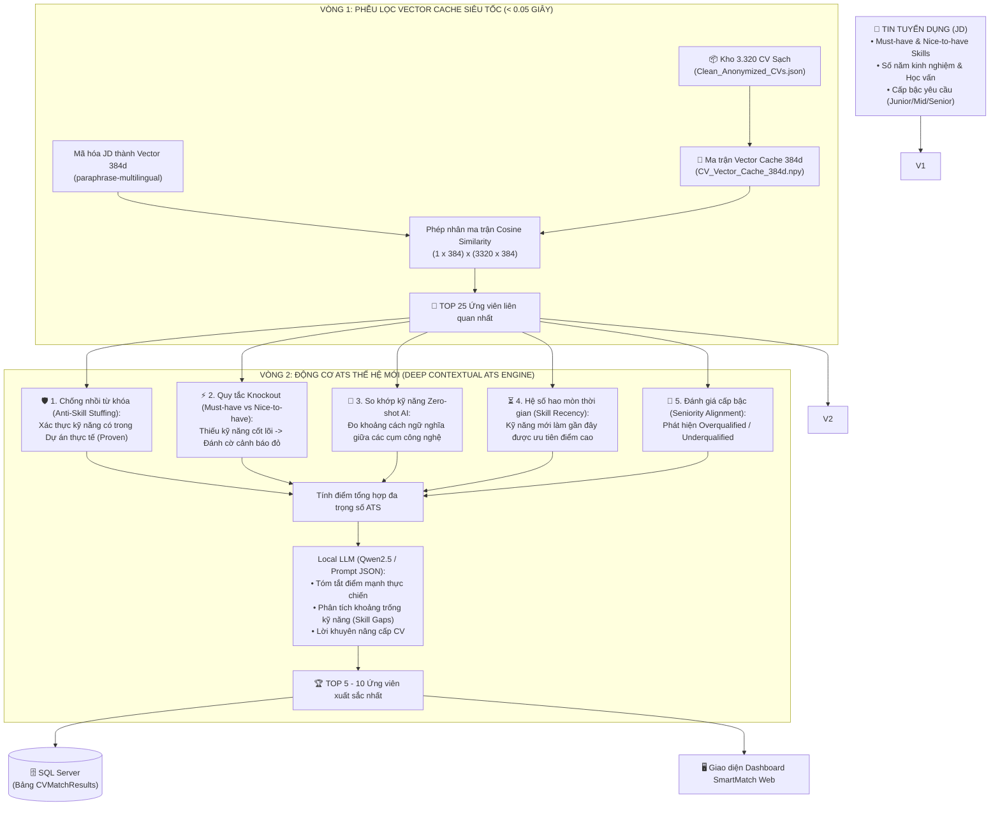

# 📋 KẾ HOẠCH TRIỂN KHAI KỸ THUẬT: ĐỘNG CƠ SO KHỚP HYBRID 2 VÒNG (NÂNG CẤP)
## SMARTCV LOCAL MULTI-MODEL AI FRAMEWORK

> **Tài liệu tham chiếu:** [ROADMAP.md](file:///ROADMAP.md)  
> **Phiên bản:** 3.0 (Kiến trúc So khớp 2 Vòng Nâng cao: Vector Cache + Động cơ ATS Chống Gian Lận & Nhận Diện Ngữ Cảnh)  
> **Mục tiêu:** Quét 3.320 CV trong `< 0.05s`, phân tích chuyên sâu Top 25 ứng viên chống nhồi từ khóa, đạt độ chính xác `> 85%` chuẩn ATS quốc tế.

---

## 🏗️ 1. TỔNG QUAN KIẾN TRÚC PHỐI HỢP 2 VÒNG



---

## ⚡ 2. VÒNG 1: PHỄU LỌC VECTOR CACHE SIÊU TỐC (FAST RETRIEVAL)

### 2.1. Nhiệm vụ cốt lõi
* **Mô hình AI:** `paraphrase-multilingual-MiniLM-L12-v2` (Bi-Encoder Transformer).
* **Mã hóa trước toàn bộ dữ liệu (Offline Pre-computed Cache):**
  * Mã hóa toàn bộ 3.320 CV từ [Data/Clean_Anonymized_CVs.json](file:///c:/Users/aaa/Pictures/DoAnWeb_CS/DoAnWeb/Data/Clean_Anonymized_CVs.json) thành ma trận số học $(3320 \times 384)$.
  * Lưu vào tệp nhị phân: `Data/CV_Vector_Cache_384d.npy` (~5.1 MB).
  * Lưu tệp chỉ mục tra cứu: `Data/CV_Vector_Index.json` mapping giữa chỉ số dòng ma trận với `resume_id`.
* **Phép toán so khớp:**
  * Nhân ma trận Cosine Similarity giữa 1 vector JD và 3.320 vector CV.
  * Tốc độ: **`< 0.05 giây`** cho toàn bộ 3.320 hồ sơ.
* **Đầu ra:** Gạn lọc ra **Top 25 ứng viên** có độ tương đồng ngữ nghĩa cao nhất để chuyển sang Vòng 2.

---

## 🔬 3. VÒNG 2: ĐỘNG CƠ CHẤM ĐIỂM ATS THẾ HỆ MỚI (NÂNG CẤP)

Vòng 2 giải quyết triệt để các nhược điểm của máy quét từ khóa truyền thống thông qua **5 cơ chế thông minh**:

### 3.1. Cơ chế 1: Chống nhồi từ khóa (Anti-Skill Stuffing & Proven Skills)
* **Thực trạng:** Ứng viên nhồi nhét hàng chục từ khóa vào mục "Kỹ năng" ở đầu CV nhưng chưa từng làm dự án thực tế.
* **Thuật toán xử lý:**
  * Tách CV thành 2 vùng: *Vùng khai báo (Declared Skills)* và *Vùng thực chiến (Project / Experience Descriptions)*.
  * Nếu kỹ năng chỉ xuất hiện ở mục khai báo suông: Tính **50% điểm uy tín (Unverified Skill)**.
  * Nếu kỹ năng xuất hiện kèm theo mô tả dự án, trách nhiệm và kết quả: Tính **100% điểm uy tín (Proven Skill)**.

### 3.2. Cơ chế 2: Phân loại Kỹ năng Bắt buộc (Must-have Knockout) & Điểm cộng (Nice-to-have)
* **Kỹ năng cốt lõi (Must-have):**
  * Ví dụ: Vị trí Backend .NET thì `C#` và `.NET Core` là bắt buộc.
  * Nếu thiếu bất kỳ kỹ năng Must-have nào: Kích hoạt cờ cảnh báo đỏ (`is_knockout = true`) và áp dụng hệ số phạt điểm nặng (trừ 30 - 40% điểm tổng).
* **Kỹ năng ưu tiên (Nice-to-have):**
  * Ví dụ: `Docker`, `Kafka`, `Redis`.
  * Có thì được cộng điểm thưởng lũy tiến, thiếu thì không bị loại.

### 3.3. Cơ chế 3: Tự động so khớp kỹ năng bằng AI (Zero-Shot Semantic Skill Matching)
* Không phụ thuộc vào từ điển cố định dễ lỗi thời.
* Sử dụng chính vector embedding đo khoảng cách ngữ nghĩa giữa cụm từ kỹ năng trong CV và JD:
  * Nếu $\text{Cosine Similarity} \ge 0.85$ (ví dụ: *"ASP.NET Core Web API"* $\leftrightarrow$ *".NET Backend Services"*): Tự động xác nhận tương đương 100%.
  * Giúp hệ thống nhận diện được hàng nghìn biến thể công nghệ mới mà không cần cập nhật code thủ công.

### 3.4. Cơ chế 4: Hệ số hao mòn theo thời gian (Skill Recency Decay)
* Kỹ năng được sử dụng trong dự án gần nhất (**trong vòng 1 - 2 năm**): Hệ số trọng số $1.0$.
* Kỹ năng chỉ xuất hiện ở các công ty cũ cách đây **3 - 5 năm**: Hệ số trọng số giảm còn $0.75$ (phản ánh độ mai một kiến thức).

### 3.5. Cơ chế 5: Đánh giá độ phù hợp cấp bậc (Seniority & Level Alignment)
* Phân tích số năm kinh nghiệm và vai trò trong quá khứ để phân loại ứng viên: `Junior`, `Middle`, `Senior`, `Lead`.
* Đánh giá độ vừa vặn:
  * Khớp chuẩn cấp bậc: Điểm tối đa.
  * Non kinh nghiệm (Underqualified): Cảnh báo thiếu năm kinh nghiệm thực chiến.
  * Thừa trình độ (Overqualified): Đánh dấu để nhà tuyển dụng cân nhắc nguy cơ không gắn bó lâu dài.

---

## 📐 4. CÔNG THỨC ĐIỂM TỔNG HỢP ATS (ADVANCED COMPOSITE SCORE)

$$\text{FinalScore} = \left[ 0.30 \cdot S_{\text{semantic}} + 0.35 \cdot S_{\text{must\_have}} + 0.15 \cdot S_{\text{nice\_have}} + 0.10 \cdot S_{\text{exp}} + 0.10 \cdot S_{\text{edu}} \right] \times \text{KnockoutFactor}$$

* Trong đó:
  * $\text{KnockoutFactor} = 1.0$ (nếu đủ toàn bộ kỹ năng bắt buộc Must-have).
  * $\text{KnockoutFactor} = 0.65$ (nếu thiếu kỹ năng cốt lõi).

---

## 📄 5. ĐỊNH DẠNG ĐẦU RA CHI TIẾT (TƯƠNG THÍCH BẢNG CSDL `CVMatchResult`)

Mỗi ứng viên trong Top 10 sau khi chấm Vòng 2 sẽ trả về JSON:

```json
{
  "resume_id": 1000,
  "match_score": 89,
  "matched_skills": "[\"C#\", \".NET Core\", \"SQL Server\", \"Docker\"]",
  "missing_skills": "[\"Kafka\", \"Redis\"]",
  "proven_skills": "[\"C#\", \".NET Core\", \"SQL Server\"]",
  "unverified_skills": "[\"Docker\"]",
  "seniority_fit": "Senior (Khớp yêu cầu JD)",
  "knockout_passed": true,
  "strengths": "4 năm kinh nghiệm làm việc thực tế với C# .NET; kỹ năng đã được chứng minh qua 2 dự án thương mại điện tử lớn.",
  "suggestions": "Cần bổ sung dự án thực tế về Message Queue (Kafka/RabbitMQ) để đạt điểm số hoàn hảo.",
  "summary": "Ứng viên rất mạnh và phù hợp cao với tiêu chuẩn vị trí Senior .NET Developer.",
  "recommendation": "strong_match"
}
```

---

## 📅 6. LỘ TRÌNH THỰC HIỆN KỸ THUẬT

| Cột mốc | Nội dung công việc cụ thể | Kết quả đầu ra |
| :--- | :--- | :--- |
| **Bước 1.3** | • Viết script batch encode 3.320 CV bằng mô hình đa ngôn ngữ<br/>• Xuất ma trận `CV_Vector_Cache_384d.npy` và `CV_Vector_Index.json`<br/>• Xây dựng API `POST /api/match/fast-filter` trong `AiMatchService` | Vector Cache 3.320 CV sẵn sàng, API Vòng 1 phản hồi `< 0.05s` |
| **Bước 1.4** | • Xây dựng module trích xuất kỹ năng thực chiến (Proven Skills) & Must-have Knockout<br/>• Viết API `POST /api/match/ats-deep-score`<br/>• Kết nối `SmartMatchController.cs` trên C# Web để lưu vào CSDL | Động cơ ATS Vòng 2 hoàn chỉnh, hiển thị dữ liệu phân tích chi tiết |
| **Bước 1.5** | • Chạy thử nghiệm thực tế với 35 JD mẫu trên 3.320 CV<br/>• Đo đạc Latency, đo tỷ lệ phát hiện ứng viên giả mạo nhồi từ khóa<br/>• Vẽ biểu đồ phân phối điểm số và bảng so sánh | Số liệu thực nghiệm khoa học đưa vào Chương 4 cuốn báo cáo khóa luận |

---

## 👥 7. PHÂN BỔ NHIỆM VỤ NHÓM 4 THÀNH VIÊN

* **Kỹ sư 1 (System & Performance):** Tối ưu hóa ma trận NumPy, cấu hình lưu trữ Vector Cache, kiểm soát độ trễ Vòng 1.
* **Kỹ sư 2 (Algorithm & ATS Logic):** Xây dựng thuật toán bóc tách kỹ năng Proven Skills, logic Knockout Rule và công thức tính điểm ATS.
* **Kỹ sư 3 (AI & Local LLM):** Thiết kế Prompt sinh đánh giá có cấu trúc JSON, chuẩn bị tích hợp Ollama cục bộ.
* **Kỹ sư 4 (Web Integration & Benchmark):** Kết nối API C# - Python, hiển thị kết quả ATS lên Dashboard Vue 3, chạy script benchmark đo đạc số liệu.
