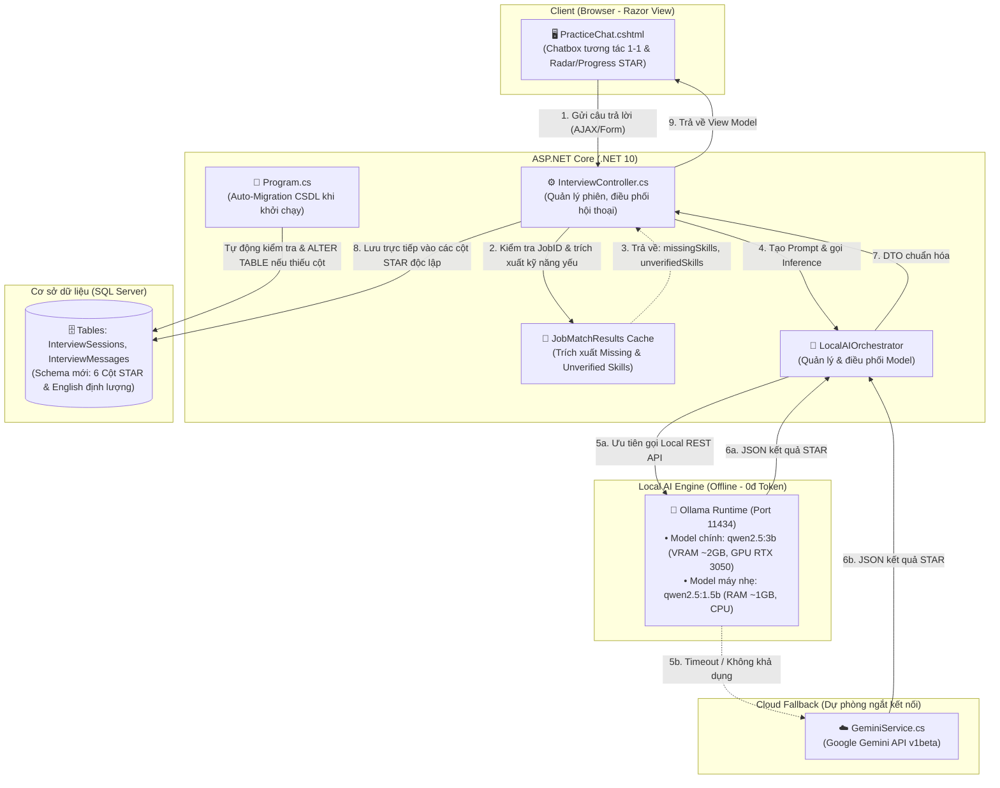

# KẾ HOẠCH KỸ THUẬT CHI TIẾT: PHÒNG PHỎNG VẤN ẢO LOCAL AI (STAR & ENGLISH POLISHING)

> **Mã tài liệu:** `PLAN-SMARTCV-STAR-2026`  
> **Phiên bản:** `2.0.0 (Production Architecture - Approved Option 2)`  
> **Phương án Database:** **Phương án 2 (Nâng cấp Schema CSDL Chuẩn hóa + Tự chạy Migration trong `Program.cs`)**  
> **Mục tiêu:** Nâng cấp phân hệ Luyện phỏng vấn AI từ việc phụ thuộc Cloud LLM (Gemini) sang **Khung AI Cục bộ Đa mô hình (Local Multi-Model Framework: Ollama Qwen 2.5 3B / 1.5B)**, tích hợp dữ liệu chẩn đoán kỹ năng từ **SmartMatch (Deep ATS Scorer)**, định lượng hóa 4 tiêu chí **STAR (Situation, Task, Action, Result)** trên các cột CSDL độc lập, trợ lý sửa lỗi tiếng Anh chuyên sâu, và tự động nâng cấp CSDL khi ứng dụng khởi chạy.

---

## 🏗️ 1. KIẾN TRÚC HỆ THỐNG TỔNG QUAN (SYSTEM ARCHITECTURE)

### 1.1. Sơ đồ khối xử lý luồng dữ liệu (Data & Control Flow)



### 1.2. Nguyên tắc thiết kế cốt lõi (Core Architectural Principles)
1. **Schema CSDL Chuẩn hóa Quan hệ (Relational Normalized Strategy):**
   - Không nhồi nhét JSON vào cột chuỗi `Feedback`.
   - Bổ sung các cột điểm định lượng riêng biệt trong bảng `InterviewMessages`:
     - `StarSituationScore INT NULL` (0 – 20đ).
     - `StarTaskScore INT NULL` (0 – 20đ).
     - `StarActionScore INT NULL` (0 – 40đ).
     - `StarResultScore INT NULL` (0 – 20đ).
     - `EnglishFeedback NVARCHAR(MAX) NULL` (Nhận xét ngữ pháp & gợi ý viết lại tiếng Anh).
     - `AiProvider VARCHAR(50) NULL` (Ghi nhận `local_qwen` hoặc `cloud_gemini`).
   - Cột `Score INT` tiếp tục lưu tổng điểm chuẩn hóa (0 – 100) để đảm bảo tương thích các màn hình tính điểm trung bình cũ.
2. **Cơ chế Khởi tạo Dữ liệu Tự động (Auto-Migration in `Program.cs`):**
   - Khi chạy `dotnet run`, ứng dụng tự động kiểm tra xem các cột mới đã tồn tại trong SQL Server chưa. Nếu chưa có, tự động thực thi script `ALTER TABLE` an toàn mà không cần thao tác thủ công.
   - Đồng bộ script vào `DtbDoAnCS/CreateTables.sql` và Model C# `Models/InterviewMessage.cs`.
3. **Local-First & High Resilience (Ưu tiên Cục bộ, Tự động Dự phòng):**
   - Ưu tiên mô hình `qwen2.5:3b` (đo đạc đạt **35.3 tokens/s** trên GPU RTX 3050).
   - Hỗ trợ máy 8GB RAM chuyển sang `qwen2.5:1.5b`.
   - Tự động fallback sang `GeminiService` nếu Ollama không phản hồi trong 30 giây.

---

## 🗄️ 2. NÂNG CẤP CƠ SỞ DỮ LIỆU & LOGIC TỰ ĐỘNG CHẠY (DATABASE UPGRADE)

### 2.1. Cập nhật Model C# (`Models/InterviewMessage.cs`)
```csharp
namespace DoAnCS.Models
{
    public class InterviewMessage
    {
        [Key]
        public int MessageID { get; set; }

        [Required]
        public int SessionID { get; set; }

        [ForeignKey("SessionID")]
        public InterviewSession Session { get; set; }

        [Required]
        public string Role { get; set; } // 'interviewer' hoặc 'candidate'

        [Required]
        public string Content { get; set; }

        public string? ChoicesJson { get; set; }
        public string? SelectedAnswer { get; set; }

        // Tổng điểm chuẩn hóa (0-100)
        public int? Score { get; set; }

        // Nhận xét tổng quan của AI
        public string? Feedback { get; set; }

        // ==========================================
        // CÁC CỘT STAR & TIẾNG ANH ĐỊNH LƯỢNG MỚI
        // ==========================================
        public int? StarSituationScore { get; set; } // Thang 20đ
        public int? StarTaskScore { get; set; }      // Thang 20đ
        public int? StarActionScore { get; set; }    // Thang 40đ
        public int? StarResultScore { get; set; }    // Thang 20đ
        
        public string? EnglishFeedback { get; set; } // Nhận xét ngữ pháp & bản viết lại tiếng Anh
        public string? AiProvider { get; set; }      // 'local_qwen_3b' hoặc 'cloud_gemini'

        public DateTime CreatedAt { get; set; } = DateTime.Now;
    }
}
```

### 2.2. Script Cập nhật trong `DtbDoAnCS/CreateTables.sql`
Thêm các cột vào định nghĩa bảng `InterviewMessages`:
```sql
ALTER TABLE InterviewMessages
ADD StarSituationScore INT NULL,
    StarTaskScore INT NULL,
    StarActionScore INT NULL,
    StarResultScore INT NULL,
    EnglishFeedback NVARCHAR(MAX) NULL,
    AiProvider VARCHAR(50) DEFAULT 'local_qwen';
```

### 2.3. Mã nguồn Tự Chạy trong `Program.cs` (Auto-Migration Safe Execution)
Chèn đoạn code tự kiểm tra và migration tự động vào `Program.cs` trước `app.Run()`:
```csharp
// --- TỰ ĐỘNG CẬP NHẬT SCHEMA DATABASE (AUTO-MIGRATION CỘT STAR) ---
using (var scope = app.Services.CreateScope())
{
    try
    {
        var context = scope.ServiceProvider.GetRequiredService<AppDbContext>();
        context.Database.ExecuteSqlRaw(@"
            IF NOT EXISTS (SELECT 1 FROM sys.columns WHERE object_id = OBJECT_ID('InterviewMessages') AND name = 'StarSituationScore')
                ALTER TABLE InterviewMessages ADD StarSituationScore INT NULL;
            IF NOT EXISTS (SELECT 1 FROM sys.columns WHERE object_id = OBJECT_ID('InterviewMessages') AND name = 'StarTaskScore')
                ALTER TABLE InterviewMessages ADD StarTaskScore INT NULL;
            IF NOT EXISTS (SELECT 1 FROM sys.columns WHERE object_id = OBJECT_ID('InterviewMessages') AND name = 'StarActionScore')
                ALTER TABLE InterviewMessages ADD StarActionScore INT NULL;
            IF NOT EXISTS (SELECT 1 FROM sys.columns WHERE object_id = OBJECT_ID('InterviewMessages') AND name = 'StarResultScore')
                ALTER TABLE InterviewMessages ADD StarResultScore INT NULL;
            IF NOT EXISTS (SELECT 1 FROM sys.columns WHERE object_id = OBJECT_ID('InterviewMessages') AND name = 'EnglishFeedback')
                ALTER TABLE InterviewMessages ADD EnglishFeedback NVARCHAR(MAX) NULL;
            IF NOT EXISTS (SELECT 1 FROM sys.columns WHERE object_id = OBJECT_ID('InterviewMessages') AND name = 'AiProvider')
                ALTER TABLE InterviewMessages ADD AiProvider VARCHAR(50) NULL;
        ");
        Console.WriteLine("[Database Auto-Migration] Xác thực các cột điểm STAR trong InterviewMessages thành công.");
    }
    catch (Exception ex)
    {
        Console.WriteLine($"[Database Auto-Migration Warning] Lỗi kiểm tra migration cột STAR: {ex.Message}");
    }
}
```

---

## 📋 3. KẾ HOẠCH TRIỂN KHAI CHI TIẾT THEO 5 GIAI ĐOẠN

---

### GIAI ĐOẠN 1: XÂY DỰNG DỊCH VỤ SUY LUẬN CỤC BỘ (`Services/OllamaService.cs`)

#### 1.1. Mục tiêu
Xây dựng service C# giao tiếp trực tiếp với Ollama API (`http://localhost:11434/api/generate`), tự động dò model và hỗ trợ fallback sang `GeminiService`.

#### 1.2. Thiết kế Lớp & Giao diện (Interface & Class Design)
* **Giao diện:** `Services/IOllamaService.cs`
```csharp
public interface IOllamaService
{
    Task<bool> IsAvailableAsync();
    Task<string?> GetActiveModelAsync();
    Task<string> GenerateJsonAsync(string prompt, string systemInstruction, double temperature = 0.15, int timeoutSeconds = 30);
}
```

* **Triển khai chi tiết:** `Services/OllamaService.cs`
  - Đăng ký trong `Program.cs`: `builder.Services.AddHttpClient<IOllamaService, OllamaService>();`.
  - Tự động ưu tiên model có sẵn: `qwen2.5:3b` ➔ `qwen2.5:1.5b` ➔ `qwen2.5-coder:7b`.
  - Cấu hình bắt buộc: `format: "json"`, `temperature: 0.15` để điểm số khách quan, không bay bổng.
  - Xử lý timeout an toàn: Bắt `HttpRequestException` hoặc `TaskCanceledException` và kích hoạt Fallback sang `GeminiService`.

---

### GIAI ĐOẠN 2: KẾT NỐI CHẨN ĐOÁN KỸ NĂNG TỪ SMARTMATCH SANG PHÒNG PHỎNG VẤN

#### 2.1. Mục tiêu
Lấy kết quả từ động cơ 2 vòng SmartMatch (Deep ATS Scorer) để AI đóng vai Trưởng phòng Kỹ thuật, chủ động đặt câu hỏi xoáy sâu vào các điểm yếu thực tế của ứng viên.

#### 2.2. Kỹ thuật kết nối dữ liệu trong `InterviewController.cs`
Trong action `StartPracticeSession` và `SubmitChatAnswer`:
1. Kiểm tra nếu `session.JobID.HasValue`:
   - Đọc tệp đệm: `Data/JobMatchResults/{jobId}.json`.
   - Tìm kiếm ứng viên tương ứng với `session.ResumeID`.
   - Trích xuất:
     - `unverifiedSkills`: Kỹ năng chỉ liệt kê chay, chưa phát hiện bằng chứng dự án cụ thể.
     - `missingSkills`: Kỹ năng JD yêu cầu nhưng hồ sơ còn thiếu.
     - `seniorityFit`: Cấp bậc ứng viên (Intern / Junior / Mid / Senior).
2. Xây dựng System Prompt phỏng vấn mục tiêu:
   ```text
   VAI TRÒ: Bạn là Trưởng phòng Kỹ thuật phỏng vấn ứng viên cho vị trí {jobTitle}.
   KẾT QUẢ PHÂN TÍCH ATS:
   - Kỹ năng cần kiểm chứng thực tế (Unverified): {unverifiedSkills}
   - Kỹ năng còn thiếu: {missingSkills}
   - Cấp bậc: {seniorityFit}
   
   YÊU CẦU ĐẶT CÂU HỎI:
   - Ưu tiên đặt câu hỏi tình huống STAR yêu cầu ứng viên chứng minh kinh nghiệm thực tế về {unverifiedSkills}.
   - Trực diện, chuyên sâu, không hỏi lý thuyết sáo rỗng.
   ```

---

### GIAI ĐOẠN 3: ĐỘNG CƠ CHẤM ĐIỂM STAR ĐỊNH LƯỢNG & SỬA LỖI TIẾNG ANH

#### 3.1. Công thức Toán học Định lượng Điểm số STAR
Điểm số của mỗi câu trả lời được tính toán tổng hợp từ 4 thành phần độc lập:
$$\text{Score}_{\text{Total}} = \text{Score}_S + \text{Score}_T + \text{Score}_A + \text{Score}_R \quad (0 \le \text{Score}_{\text{Total}} \le 100)$$

| Thành phần STAR | Thang điểm | Tiêu chí đánh giá của AI Rubric |
| :--- | :---: | :--- |
| **S (Situation)** | **20đ** | Bối cảnh dự án, quy mô người dùng, bài toán hoặc sự cố gặp phải có rõ ràng, mạch lạc không? |
| **T (Task)** | **20đ** | Trách nhiệm, mục tiêu cá nhân, KPI hoặc phạm vi công việc của ứng viên được định nghĩa thế nào? |
| **A (Action)** | **40đ** | **Trọng tâm kỹ thuật:** Các công nghệ, thuật toán, kiến trúc (Redis, Docker, SQL Index, Pattern) và hành động cụ thể do chính ứng viên trực tiếp thực hiện. |
| **R (Result)** | **20đ** | Kết quả đạt được có đo lường bằng con số cụ thể không (% cải thiện tốc độ, độ trễ ms, doanh thu, thời gian release)? |

#### 3.2. Cấu trúc JSON Đánh giá từ LLM & Lưu vào Database
JSON phản hồi từ LLM:
```json
{
  "situation_score": 18,
  "situation_comment": "Bối cảnh dự án rõ ràng, nêu bật được áp lực lượng truy cập tăng cao...",
  "task_score": 16,
  "task_comment": "Xác định tốt nhiệm vụ giảm độ trễ truy vấn xuống dưới 200ms...",
  "action_score": 34,
  "action_comment": "Áp dụng đúng kỹ thuật đánh index và cache Redis vào tầng Application...",
  "result_score": 14,
  "result_comment": "Có số liệu đo lường thực tế giảm 40% latency, nhưng cần nêu thêm số lượng user...",
  "total_score": 82,
  "general_feedback": "Câu trả lời tương đối hoàn chỉnh, nêu bật được tư duy kiến trúc...",
  "english_polish": {
    "is_english": true,
    "grammar_feedback": "Lỗi thì quá khứ ở cụm 'I implement Redis' -> nên dùng 'I implemented Redis'.",
    "better_version": "In my previous project, to tackle database latency under high traffic, I integrated Redis as a caching layer..."
  }
}
```

Khi nhận được JSON này, Backend C# gán trực tiếp:
```csharp
candidateMsg.StarSituationScore = evalDto.situation_score;
candidateMsg.StarTaskScore = evalDto.task_score;
candidateMsg.StarActionScore = evalDto.action_score;
candidateMsg.StarResultScore = evalDto.result_score;
candidateMsg.Score = evalDto.total_score;
candidateMsg.Feedback = evalDto.general_feedback;
candidateMsg.EnglishFeedback = JsonSerializer.Serialize(evalDto.english_polish);
candidateMsg.AiProvider = providerName; // "local_qwen_3b" hoặc "cloud_gemini"
```

---

### GIAI ĐOẠN 4: NÂNG CẤP GIAO DIỆN CHATBOX PHỎNG VẤN (`PracticeChat.cshtml`)

#### 4.1. Thiết kế Giao diện Phản hồi Chuyên sâu
Tại mỗi bong bóng tin nhắn của ứng viên, hiển thị:
1. **Huy hiệu Nguồn Suy luận (Inference Badge):**
   - Xanh lá: `Local AI (Qwen 2.5 3B) - 0đ Token`
   - Xanh dương: `Cloud AI (Gemini)`
2. **Khối 4 Thanh Tiến trình STAR (STAR Progress Bars):**
   - **S (Tình huống):** Progress bar màu Cyan (`bg-info`), `{score} / 20đ`.
   - **T (Nhiệm vụ):** Progress bar màu Vàng (`bg-warning`), `{score} / 20đ`.
   - **A (Hành động):** Progress bar màu Xanh lá (`bg-success`), `{score} / 40đ`.
   - **R (Kết quả):** Progress bar màu Tím (`bg-purple`), `{score} / 20đ`.
   - Accordion xem chi tiết nhận xét từng tiêu chí.
3. **Tab Trợ lý Tiếng Anh (English Polishing Card):**
   - Khối nhận xét lỗi ngữ pháp.
   - So sánh câu gốc và câu đề xuất viết lại chuyên nghiệp, kèm nút sao chép (Copy).

---

### GIAI ĐOẠN 5: KIỂM THỬ THỰC TẾ, ĐO ĐẠC HIỆU NĂNG & NGHIỆM THU

#### 5.1. Kịch bản Kiểm thử Tự động (Automated Test Scenarios)
1. **Test Case 1 (Auto-Migration Verification):**
   - Khởi động `dotnet run`.
   - Kiểm tra SQL Server: Đảm bảo 6 cột STAR đã xuất hiện trong bảng `InterviewMessages`.
2. **Test Case 2 (Happy Path - Local AI Qwen 3B):**
   - Bật Ollama `qwen2.5:3b`.
   - Gửi câu trả lời phỏng vấn.
   - Xác nhận: Phản hồi trong 3 - 5 giây (đạt > 30 tokens/s), các cột điểm `StarSituationScore`, `StarTaskScore`, `StarActionScore`, `StarResultScore` được lưu chuẩn xác vào SQL Server.
3. **Test Case 3 (Resilience & Fallback Test):**
   - Tắt tiến trình Ollama.
   - Gửi câu trả lời phỏng vấn.
   - Xác nhận: Tự động chuyển tiếp sang Gemini API, `AiProvider` ghi nhận `cloud_gemini`, không phát sinh lỗi giao diện.
4. **Test Case 4 (English Polishing Test):**
   - Gửi câu trả lời tiếng Anh có lỗi ngữ pháp.
   - Xác nhận: Cột `EnglishFeedback` lưu đúng lỗi ngữ pháp và bản viết lại tự nhiên.

#### 5.2. Tiêu chí Nghiệm thu Tuyệt đối (Strict Acceptance Criteria)
* [ ] Database SQL Server tự động tạo 6 cột STAR khi chạy ứng dụng mà không cần chạy tay câu lệnh SQL.
* [ ] `DtbDoAnCS/CreateTables.sql` và Model C# đồng bộ 100%.
* [ ] Mã nguồn C# biên dịch sạch sẽ (`dotnet build /t:Compile` đạt **0 Warning, 0 Error**).
* [ ] Tốc độ phản hồi trung bình của `qwen2.5:3b` trên máy đạt **> 30 tokens/giây**.
* [ ] Ghi chép đầy đủ vào `CHANGELOG.md` và `AI_USAGE_LOG.md` theo chuẩn đề tài.

---

*Tài liệu này là căn cứ kỹ thuật chuẩn mực để đối chiếu, kiểm tra chéo bằng Codex và triển khai từng bước trong kho mã nguồn.*
